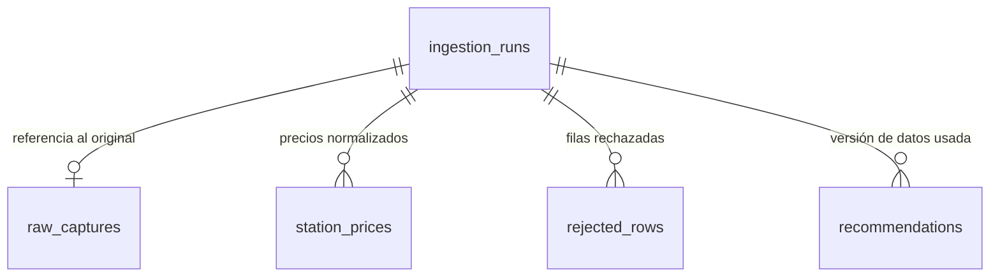

# Persistencia e ingesta de la POC

Implementa la tarea POC-06 (#11), correspondiente a RF08, RNF03 y RNF05 del
[PRD](PRD.md). La elección del motor está justificada en el
[ADR-005](../adr/ADR-005-persistencia-de-la-poc.md).

| Módulo | Responsabilidad |
|---|---|
| `nafta2go/persistence/database.py` | URL de la base, conexión y migraciones |
| `nafta2go/persistence/schema.py` | Tablas |
| `nafta2go/persistence/repository.py` | Lectura y escritura; la transacción la decide quien llama |
| `nafta2go/persistence/models.py` | `RawCapture` y `NormalizationResult`, el contrato con la normalización |
| `nafta2go/services/ingestion.py` | Ciclo de vida de una ejecución de ingesta |
| `migrations/` | Migraciones de Alembic |

## Uso local

La URL de la base sale de `DATABASE_URL`. Si no está definida, se usa
`data/nafta2go.db` dentro de la raíz del repositorio, sin importar desde qué
carpeta se ejecute. El directorio `data/` está en `.gitignore`.

```bash
alembic upgrade head      # crea o actualiza el esquema
alembic downgrade base    # lo elimina
```

Para cambiar el esquema: modificar `schema.py`, crear una migración con
`alembic revision -m "descripcion"` y escribir `upgrade` y `downgrade`. El test
`test_migration_matches_schema_metadata` falla si la migración y `schema.py` no coinciden.

## Esquema



| Tabla | Qué guarda |
|---|---|
| `ingestion_runs` | Una ejecución: origen (`vigente` o `historico`), estado (`running`, `succeeded`, `failed`), inicio, fin, versión de las reglas, reporte de calidad (JSON) y error |
| `raw_captures` | El archivo original: URL, SHA-256, tamaño, ruta local, fecha de descarga y `last_modified` de la fuente. No guarda el contenido: el histórico pesa unos 780 MB |
| `station_prices` | Precios normalizados con los valores originales de fecha y precio (`valid_from_raw`, `price_raw`), la fila del archivo (`source_row`) y las alertas de calidad |
| `rejected_rows` | Filas rechazadas: fila del archivo, motivo y valores crudos en JSON |
| `recommendations` | Recomendación: ejecución de datos usada, versión del motor, proveedor de rutas, parámetros y resultado |

Las fechas de ejecución se guardan en UTC. `valid_from` conserva la hora local
publicada por la fuente.

## Ciclo de vida de una ejecución

`ingest(engine, capture, normalize)` hace lo siguiente:

1. En una transacción propia, crea la ejecución en estado `running` y la confirma.
2. Llama al normalizador y verifica que el reporte coincida con lo recibido
   (`filas_validas` y `filas_rechazadas`).
3. En **una sola** transacción guarda la captura, los precios y los rechazos, y
   cierra la ejecución como `succeeded`.
4. Si cualquier paso falla, esa transacción se revierte entera y otra marca la
   ejecución como `failed` con el tipo y el mensaje del error. La función lanza
   `IngestionFailed` con el `run_id`.

Con esto, una ejecución fallida nunca deja datos parciales ni aparece como
exitosa. Si el proceso se corta entre los pasos 1 y 3, la ejecución queda en
`running`. Volver a ingerir una captura con el mismo SHA-256 crea una ejecución
nueva y guarda `duplicate_of_run_id` en su reporte.

## Contrato con la normalización (POC-01)

El normalizador es una función `RawCapture -> NormalizationResult`. Así la
persistencia no depende de cómo se normaliza:

- `rows`: una fila por precio válido, con las claves `fila_origen`, `idempresa`,
  `empresa`, `empresabandera`, `direccion`, `idproducto`, `tipo_nafta`,
  `idtipohorario`, `precio`, `fecha_vigencia`, `latitud`, `longitud`,
  `fecha_vigencia_original`, `precio_original` y `alertas`. Un DataFrame se pasa
  con `df.to_dict("records")`.
- `rejections`: `fila_origen`, `motivo` y el resto de las columnas crudas.
- `report`: el reporte de calidad. Si trae `filas_validas` o `filas_rechazadas`,
  tienen que coincidir con lo entregado.
- `rules_version`: la versión de las reglas de normalización.

Los precios se guardan como `Decimal`. Las coordenadas faltantes o `NaN` quedan
como `NULL`. Los valores que no se pueden representar en JSON (fechas, `Decimal`,
`NaN`) se convierten a texto o `null`, tanto en los valores crudos de los rechazos como
en el reporte de calidad de la ejecución. Las alertas faltantes quedan vacías y
una lista de alertas se guarda separada por `; `.

## Versión de datos de una recomendación

La versión de datos es el `id` de la última ejecución exitosa del origen usado
(`latest_successful_run`). `record_recommendation` exige que esa ejecución esté
en `succeeded` y guarda solo los parámetros del vehículo y el presupuesto
(`ALLOWED_REQUEST_KEYS`). Rechaza cualquier otro campo, en particular origen,
destino y coordenadas, porque las ubicaciones de los usuarios no se conservan (RNF03).

## Pendiente

- Conectar la descarga y la normalización reales cuando exista POC-01.
- Registrar recomendaciones desde el flujo de punta a punta (POC-05).
