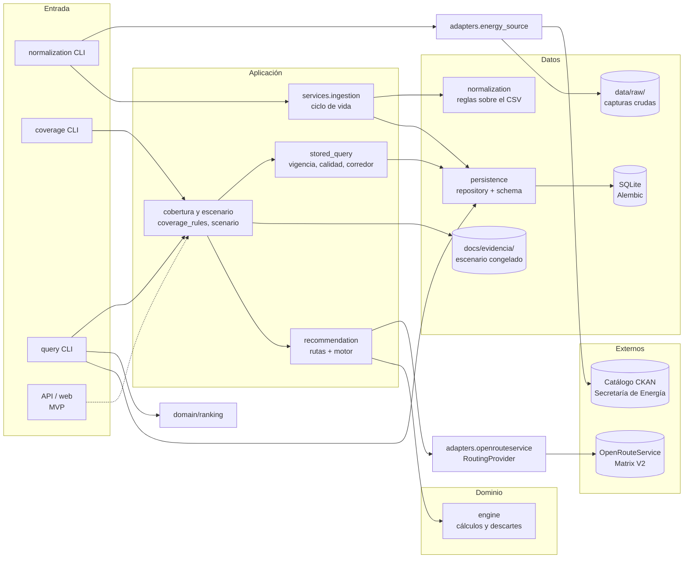
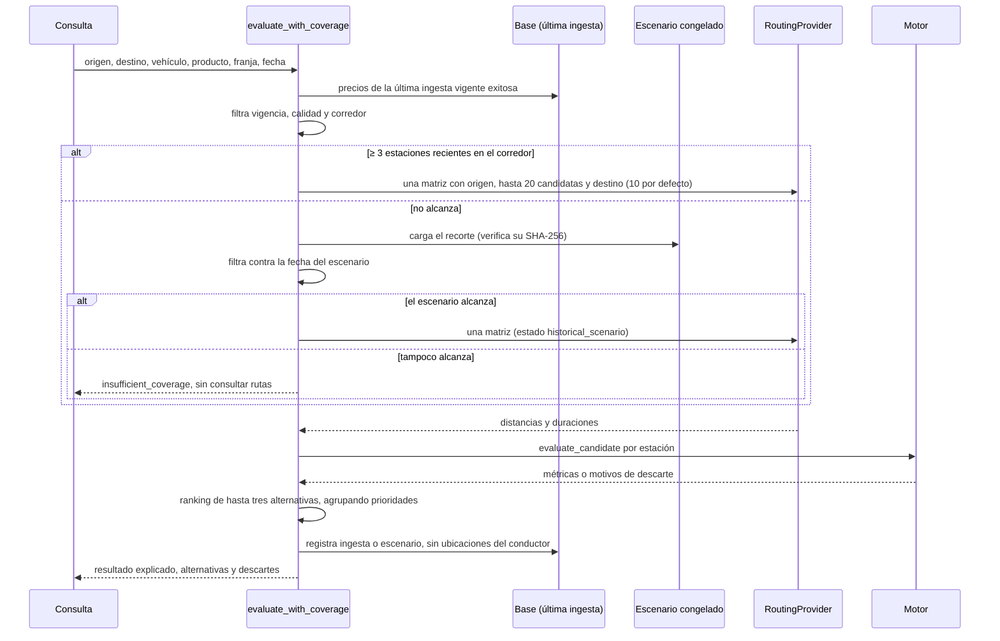
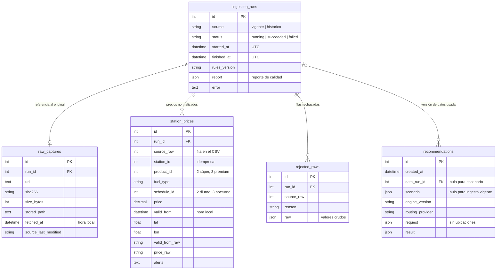
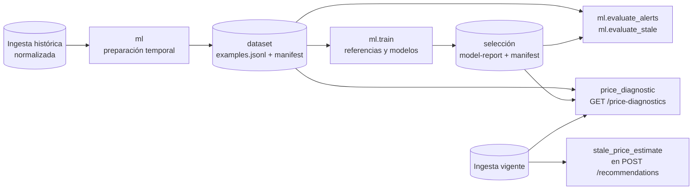

# SRD — Especificación técnica de Nafta2Go

Documento de requisitos y diseño del sistema (System Requirements/Design
Document). Se escribió para la **Entrega 2: POC** y se actualizó para la
**Entrega 3: MVP**. Traduce el [PRD](PRD.md) a una especificación técnica:
- La arquitectura, con su patrón y sus diagramas.
- El stack tecnológico justificado.
- El modelo de datos.
- Los contratos de las interfaces principales.
- La estrategia de datos.

En la Entrega 2, como pedía la consigna, no incluía los componentes de ML. Para
el MVP se agrega la [sección 11](#11-componentes-de-ml-entrenamiento-serving-y-monitoreo):
entrenamiento, serving y monitoreo del diagnóstico de precios.

Las secciones 1 a 10 conservan el diseño de la POC; la tabla de trazabilidad
indica el estado actual de cada requisito. El detalle de cada componente está en su documento:
[NORMALIZACION](NORMALIZACION.md), [PERSISTENCIA](PERSISTENCIA.md),
[COBERTURA](COBERTURA.md), [RUTAS](RUTAS.md), [MOTOR](MOTOR.md) y
[CALIDAD](CALIDAD.md). Las decisiones estructurales están en los
[ADRs](../adr/README.md).

## 1. Alcance de la POC

La POC valida el camino técnico de punta a punta para **un caso de uso**: un
conductor en CABA busca dónde cargar nafta súper o premium yendo de un origen a
un destino (UC01), o yendo y volviendo desde un origen (UC02). No hay interfaz
gráfica: los componentes se usan desde comandos y desde código.

El mayor riesgo del proyecto, la baja cobertura de precios recientes, quedó
resuelto en POC-02 de esta forma:
- La cobertura se mide cerca del recorrido.
- Si no alcanza, se usa un escenario histórico congelado y rotulado.
- Nunca se presentan precios viejos como actuales.

## 2. Trazabilidad con el PRD

| Requisito | Componente | Estado |
|---|---|---|
| RF01 Validar la consulta | `domain/engine.FuelRequest`, validaciones de `application/stored_query` | Implementado: rechaza valores faltantes, no numéricos, no finitos o inconsistentes nombrando el campo |
| RF02 Filtrar CABA y nafta compatible | `normalization/reading` (alcance), `stored_query` (producto, franja y caja de CABA) | Implementado |
| RF03 Preseleccionar y enrutar candidatas | `stored_query`, `application/recommendation.evaluate_stations` | Admite hasta 20 mediante límite explícito; diez por defecto para reproducir la POC. Veinte probado con proveedor simulado |
| RF04 Cálculos de alcanzabilidad, reserva, consumo, capacidad, litros y desvío | `domain/engine.evaluate_candidate` | Implementado, determinístico |
| RF05 Descartar alternativas inviables con motivo | `domain/engine.DiscardReason`, exclusiones de `stored_query` | Implementado |
| RF06 Hasta tres alternativas diferenciadas | `domain/ranking`, `application/query` | Implementado: combustible neto, menor desvío y equilibrio; agrupa prioridades que eligen la misma estación |
| RF07 Explicar cada resultado | `query` CLI y `application/query` | Implementado: dirección, precio, fecha, litros, consumo, reserva, desvío, alertas y fuente; JSON con todos los descartes |
| RF08 Ingerir y normalizar | `adapters/energy_source`, `normalization/`, `services/ingestion` | Implementado, con corrida real documentada |
| RF09 Umbral configurable de vigencia | `application/coverage_rules`, `stored_query` | Implementado: 30 días, configurable en un solo módulo. Estimación rotulada de 31 a 120 días (ADR-020) en `application/stale_price_estimate`, fuera del ranking |
| RF10 Diagnóstico de precio | `application/price_diagnostic`, `ml/` | Parcial: sirve la referencia elegida y su versión (ADR-015), con `alert_level=not_calibrated` hasta aprobar una política de alertas (#19). Ver sección 11 |
| RF11 Ranking conservador | — | Pendiente: la regla se discute en #20 |
| RF12 Autenticación administrativa | `presentation/http`, `NAFTA2GO_ADMIN_TOKEN` | Implementado: token administrativo separado del de conductor (ADR-016) |
| RF13 Configurar sin modificar código | Variables de entorno, `compose.yaml` | Parcial: vigencia, caché y cupo de rutas se configuran por entorno; no hay auditoría de cambios |
| RF14 Estado operativo | `/operacion`, `GET /api/v1/operations` | Parcial: ingestas, alertas y contadores; faltan métricas del modelo |
| RF15 Escenarios históricos | `application/scenario`, `docs/evidencia/escenario-vigente-2026-10-24/` | Implementado como respaldo automático y rotulado |
| RNF03 Privacidad | `persistence/repository.record_recommendation` | Implementado: rechaza origen, destino y coordenadas en la consulta guardada |
| RNF05 Trazabilidad | `ingestion_runs`, `raw_captures`, `recommendations.data_run_id`, rótulo `scenario` | Implementado: ingesta, recomendación persistida y escenario identificado por fecha y hashes |
| RNF06 Calidad | CI: links, lint, tests, secretos y contenedores | Implementado: cobertura de líneas ≥ 90%, 0 tests fallidos y job Tests ≤ 5 min |
| RNF07 Portabilidad | `Dockerfile`, `compose.yaml`, configuración por variables de entorno | Implementado para la POC: migraciones y comando de consulta completo; reproducción sin red en CI |

## 3. Arquitectura

### Patrón

**Aplicación modular por capas con adaptadores** (puertos y adaptadores en los
bordes), según el [ADR-004](../adr/ADR-004-arquitectura-por-capas.md). Se eligió
frente a microservicios desde el inicio y frente a una arquitectura orientada a
eventos, porque el caso principal es una consulta síncrona que necesita una
respuesta explicada. Las reglas tienen que poder probarse sin red ni
infraestructura.

| Capa | Paquete | Responsabilidad | Depende de |
|---|---|---|---|
| Dominio | `nafta2go/domain/` | Reglas de negocio puras: cálculos de combustible, factibilidad y motivos de descarte | Nada del sistema |
| Aplicación | `nafta2go/application/`, `nafta2go/services/` | Casos de uso: seleccionar candidatas, decidir cobertura, conectar rutas y motor, orquestar la ingesta | Dominio, puertos de los adaptadores, persistencia |
| Normalización | `nafta2go/normalization/` | Reglas de calidad de datos sobre el CSV crudo | pandas |
| Persistencia | `nafta2go/persistence/` | Esquema, migraciones y repositorios | SQLAlchemy |
| Adaptadores | `nafta2go/adapters/` | Fuentes externas: catálogo de la Secretaría de Energía y OpenRouteService | requests |
| Presentación (MVP) | `nafta2go/presentation/` | API HTTP, web y panel de operación; no calcula precios ni accede a tablas | Aplicación, FastAPI |
| ML offline (MVP) | `nafta2go/ml/` | Preparación temporal, entrenamiento y evaluaciones; no corre en la consulta | pandas, scikit-learn |
| Entrada | `python -m nafta2go.normalization`, `python -m nafta2go.coverage`, `python -m nafta2go.query`, `scripts/` | Comandos de la POC | Aplicación |

Las reglas de dependencia son estas:
- El dominio no importa nada de las otras capas.
- La aplicación habla con las rutas a través del protocolo `RoutingProvider` y
  nunca con OpenRouteService directamente.
- Ninguna capa de negocio escribe SQL: todo pasa por `repository`.

El primer incremento HTTP de MVP-02 agrega `presentation/`, con FastAPI sobre
`application.query`: la presentación no calcula precios ni accede directamente a
tablas. Contrato, token local y controles de salud en [API](API.md); decisión en
[ADR-009](../adr/ADR-009-api-http-con-fastapi.md). La primera web local se describe en [WEB](WEB.md).

En el MVP se suman una capa de **presentación** (API HTTP y web) por encima de
la aplicación, y el **diagnóstico ML** como un componente separado que la
aplicación consulta (ver el [ADR-002](../adr/ADR-002-recomendador-deterministico-y-diagnostico-ml.md)).

### Diagrama de componentes

### Flujo de ingesta (implementado)

1. `ingest_from_source` abre la ejecución en estado `running`, en su propia
   transacción, antes de consultar la fuente.
2. `discover_resources` lee el catálogo y encuentra los CSV vigente e histórico.
3. `download` baja el CSV a `data/raw/<origen>/`. Lo escribe primero como
   `.part` y lo renombra solo si el tamaño coincide con el del catálogo. Calcula
   el SHA-256.
4. `normalize_capture` lee por chunks, filtra CABA y nafta y aplica las reglas.
   Entrega las filas válidas, los rechazos con motivo y un reporte de calidad.
5. En una segunda transacción se guardan la referencia a la captura, los
   precios, los rechazos y el cierre `succeeded`. Si algo falla, se revierte
   todo y la ejecución queda `failed`.

### Flujo de consulta (implementado)

El comando `python -m nafta2go.query` conecta esos pasos mediante
`application.query.recommend`. La [evidencia real y el procedimiento de POC-05](POC-05.md)
incluyen ingesta desde el CSV completo, matriz autenticada, ranking y registro.

## 4. Stack tecnológico

| Tecnología | Uso | Por qué | Alternativa considerada |
|---|---|---|---|
| Python 3.12 | Todo el sistema | Un solo lenguaje para datos, reglas y servicios. El equipo ya lo usa en la exploración. Tipado moderno y `zoneinfo` | — |
| FastAPI + Pydantic + Uvicorn | API local de MVP-02 | Contrato tipado y OpenAPI sin duplicar el caso de uso; versiones en requirements.txt | Flask o Django/DRF ([ADR-009](../adr/ADR-009-api-http-con-fastapi.md)) |
| pandas 2 | Normalización | El histórico tiene 3,4 millones de filas (780 MB). Se lee por chunks con operaciones vectorizadas: unos 2 minutos y 630 MB de memoria | Leer con el módulo `csv` fila por fila (más lento y más código) |
| `decimal.Decimal` | Motor y precios | Entradas limitadas a 28 cifras significativas, métricas Decimal y restricciones exactas con Fraction; compra redondeada hacia abajo | `float` |
| requests | Catálogo, descarga y rutas | Sesión inyectable: los tests reemplazan la red por una sesión falsa | httpx (no hace falta asincronía en la POC) |
| SQLite + SQLAlchemy 2 Core + Alembic | Persistencia | Sin servidor, transaccional y suficiente para el volumen de la POC (~730 filas por captura vigente). SQLAlchemy permite pasar a PostgreSQL en el MVP sin reescribir los repositorios. Alembic versiona el esquema | PostgreSQL desde el inicio; archivos CSV/JSON ([ADR-005](../adr/ADR-005-persistencia-de-la-poc.md)) |
| OpenRouteService Matrix V2 | Distancias y tiempos | Una sola solicitud por consulta devuelve todos los tramos. La cuota diaria alcanza ([RUTAS](RUTAS.md)) | OSRM propio, que queda como plan alternativo detrás del mismo protocolo ([ADR-003](../adr/ADR-003-proveedor-de-rutas.md)) |
| Docker + Compose | Ejecución local y CI | Misma imagen en la máquina y en el CI. Prepara la salida a cloud (RNF07) | Instalación local únicamente |
| GitHub Actions | Integración continua | Checks requeridos en `dev` y `main`: links, ruff, pytest, gitleaks y contenedores ([CALIDAD](CALIDAD.md)) | — |
| scikit-learn | Modelos de precios offline (MVP-04) | Ridge y árboles potenciados con semilla fija y un hilo, reproducibles byte a byte ([ML](ML.md)) | Sólo referencias estadísticas, sin modelos aprendidos ([ADR-014](../adr/ADR-014-seleccion-de-modelo-de-precios.md)) |
| pytest + pytest-cov + ruff | Calidad | Tests sin red y con bases temporales; cobertura de líneas ≥ 90% controlada en CI. Un único linter y formateador | flake8 + black |

El incremento #55 incorpora caché volátil de matrices y cupo local por proceso y
credencial en los adaptadores. Conserva fecha y hash, recalcula precios y no
persiste ubicaciones. Configuración y limitaciones en [RUTAS](RUTAS.md) y
[ADR-010](../adr/ADR-010-cache-volatil-y-cupo-de-rutas.md).

## 5. Modelo de datos

Estas son las reglas del modelo:

- **Una ejecución es una versión de datos.** Una consulta lee precios de una
  sola ejecución `succeeded` y nunca mezcla capturas.
- **Valores originales.** `valid_from_raw`, `price_raw`, `source_row` y
  `rejected_rows.raw` conservan lo que dijo la fuente. El archivo crudo se
  referencia por su SHA-256 y no se guarda en la base.
- **Clave de precio.** `(run_id, station_id, product_id, schedule_id,
  valid_from)` es única.
- **Zonas horarias.** Las fechas de la ejecución van en UTC. `valid_from` y
  `fetched_at` van en hora local de Argentina sin zona, como publica la fuente.
- **Privacidad (RNF03).** `recommendations.request` no admite origen, destino
  ni coordenadas.
- **Escenario histórico.** Los precios no son una tabla: se leen desde
  `docs/evidencia/escenario-vigente-2026-10-24/` y no se ingiere. Así nunca
  puede tomarse como la última captura. Las recomendaciones guardan su ID, fecha
  y hashes en `scenario`; un CHECK exige exactamente uno entre ingesta y escenario
  ([ADR-007](../adr/ADR-007-trazabilidad-de-recomendaciones-historicas.md)).

## 6. Contratos de las interfaces principales

### Externos

| Interfaz | Contrato | Errores |
|---|---|---|
| Catálogo CKAN (`package_show?id=precios-en-surtidor`, por HTTP) | Recursos CSV cuyo nombre contiene "vigentes" e "historicos", con `url`, `size` y `last_modified` | Falta un recurso → `LookupError`. Bytes recibidos ≠ `size` → `IncompleteDownload`, sin dejar archivo |
| CSV vigente | 19 columnas; `fecha_vigencia` en formato `AAAA-MM-DD HH:MM:SS`; precio entero | Columnas faltantes → `UnexpectedSchema` con sus nombres |
| CSV histórico | 18 columnas, incluidas `anio` y `mes`; `fecha_vigencia` en formato `DD/MM/AAAA HH:MM` (día primero) | Ídem |
| OpenRouteService Matrix V2 | Hasta 22 ubicaciones (origen, 20 candidatas y destino); timeout de 5 s de conexión y 15 s de lectura | `InvalidCredentials`, `QuotaExceeded`, `InvalidRequest`, `ProviderTimeout`, `ProviderUnavailable` (todos son `RoutingError`) |

### Internos

| Interfaz | Entrada | Salida |
|---|---|---|
| `RoutingProvider.matrix(sources, destinations)` | Listas de `Point(lat, lon)` | `DistanceMatrix`: metros y segundos, `None` si un par no tiene ruta |
| `normalize_capture(RawCapture)` | Captura guardada: origen, URL, SHA-256, ruta y `fetched_at` | `NormalizationResult`: filas válidas, rechazos con `motivo`, reporte y `rules_version` |
| `ingest(engine, capture, normalize)` | Captura y normalizador | `run_id`; si falla, `IngestionFailed` y la ejecución queda `failed` |
| `evaluate_candidate(FuelRequest, precio, Route)` | Consumo, tanque, litros iniciales, presupuesto, reserva; tramos en km y min | `Evaluation`: `FuelMetrics` si es factible, o motivos de `DiscardReason` |
| `application.query.recommend` | Consulta validada, conexión y proveedor | Alternativas explicadas y descartes, con resultado persistido sin ubicaciones |
| `select_with_coverage` / `evaluate_with_coverage` | Origen, destino opcional, producto, franja, fecha con zona | `CoverageQueryResult`: estado, selección usada y rotulada, selección actual, selección del escenario y evaluaciones |

Estados de cobertura (`CoverageStatus`):

| Estado | Significado |
|---|---|
| `ready` | Datos actuales: al menos 3 estaciones recientes en el corredor |
| `historical_scenario` | Escenario congelado, rotulado con su fecha de referencia |
| `insufficient_coverage` | No alcanza ninguna fuente; no se consultan rutas |
| `no_successful_ingestion` | Estado de la selección actual cuando todavía no hay ingesta exitosa |

Motivos de descarte del motor: `route_unavailable`, `station_unreachable`,
`reserve_at_station`, `no_budget`, `no_tank_space` e
`insufficient_fuel_for_trip`.

Exclusiones de la selección: `incompatible_product`, `incompatible_schedule`,
`future_price`, `stale_price`, `invalid_price`, `missing_coordinates`,
`invalid_coordinates`, `outside_caba`, `outside_corridor` y
`superseded_price`.

### Comandos

| Comando | Qué hace |
|---|---|
| `python -m nafta2go.normalization --source {vigente,historico} [--file RUTA]` | Descarga (o usa un CSV), normaliza, ingiere e imprime el reporte |
| `python -m nafta2go.coverage --origin=LAT,LON [--destination=LAT,LON]` | Reporta la cobertura y la decisión de la consulta, sin consultar rutas |
| `python -m nafta2go.query --origin=LAT,LON [--destination=LAT,LON]` | Consulta explicada, ranking y registro; `--matrix-file` reproduce una matriz real guardada |
| `python scripts/probe_openrouteservice.py` | Prueba autenticada del proveedor de rutas |
| `python scripts/freeze_scenario.py --file ...` | Congela un escenario histórico |

## 7. Estrategia de datos

| Aspecto | Decisión |
|---|---|
| Fuente | Dataset oficial "Precios en surtidor" de la Secretaría de Energía, licencia CC BY 4.0. Vigente (~9 MB) e histórico (~780 MB) |
| Captura | Descarga completa por HTTP. El portal redirige HTTPS a HTTP y el DataStore ya no existe. La integridad se cubre con el tamaño del catálogo y el SHA-256. El crudo queda en `data/raw/` (no versionado) y nunca se modifica |
| Alcance | CABA (`provincia` CAPITAL FEDERAL) y nafta súper o premium. Se descartan en la lectura |
| Calidad | Reglas explícitas que **no corrigen datos**: rechazan con motivo (fecha inválida, futura o inconsistente, precio inválido o no positivo, clave en conflicto) o marcan una alerta (precio atípico, fuera de CABA, sin coordenadas) ([NORMALIZACION](NORMALIZACION.md)) |
| Fechas | Formato fijo por origen. Leer el histórico con el mes primero explicaba las fechas futuras de la Entrega 1 |
| Versionado | Cada ingesta es una versión (`run_id`) con su captura, reglas (`rules_version`) y reporte. Las recomendaciones apuntan a esa versión |
| Vigencia y cobertura | Un precio es reciente si tiene hasta 30 días. Se exigen 3 estaciones recientes en un corredor de 5 km del recorrido. Los parámetros están en `coverage_rules.py` ([COBERTURA](COBERTURA.md)) |
| Respaldo | Escenario histórico congelado (vigente del 24/10/2026, 732 filas versionadas con su SHA-256), activado solo y rotulado ([ADR-006](../adr/ADR-006-escenario-historico-de-la-poc.md)) |
| Frecuencia | En la POC, la ingesta se corre a mano con el comando. En el MVP será diaria y programada (RF08), con alerta si falla |
| Privacidad | No se guardan ubicaciones de usuarios. Los datos de la fuente son públicos y de empresas |
| Datos para ML | El histórico normalizado (80.008 filas válidas de CABA, 2015-2026) alimenta la preparación temporal de la sección 11 |

## 8. Calidad, configuración y operación

- **Integración continua:** seis checks en cada push y PR a `dev` y `main`:
  `Docs y notebooks`, `Lint`, `Tests`, `Secretos`, `Contenedores` y
  `Web y accesibilidad`. Los seis son requeridos por el ruleset ([CALIDAD](CALIDAD.md)).
- **Tests:** unitarios para dominio y reglas, de integración contra un SQLite
  migrado y de contrato con sesiones HTTP falsas. Ningún test usa red. Las
  fixtures salen de filas reales de la fuente. Se exige cobertura de líneas de
  `nafta2go` ≥ 90% y el job Tests tiene un límite de 5 minutos.
- **Configuración:**
  - `DATABASE_URL` y `ORS_API_KEY`, por variables de entorno, con un
    `.env.example` sin valores reales.
  - Los parámetros de negocio están en `coverage_rules.py` y `normalization/rules.py`.
- **Ejecución local:** con `python -m pip install -r requirements-dev.txt`
  y `alembic upgrade head`, o con `docker compose up --build`, que construye la
  imagen y migra la base en un volumen. `docker compose run --rm query` ejecuta
  el flujo completo; ver [POC-05](POC-05.md).
- **Observabilidad:** las ingestas y las descargas registran logs con campos
  (`run_id`, filas, rechazos, SHA-256). El reporte de calidad queda en cada
  ejecución. El comando de ingesta ofrece estado, fechas y duración con `--json`,
  incluidos fallos de adquisición. Las alertas automáticas de RNF08 siguen pendientes.

## 9. Partes simplificadas y evolución al MVP

| Parte | Simplificación | Plan para el MVP |
|---|---|---|
| Interfaz | API HTTP y web local con código de demo y caché por proceso | QA de navegador automatizado; faltan coordinación entre réplicas y despliegue público |
| Ranking | Tres prioridades determinísticas; equilibrio con igual peso a ganancia neta y km extra normalizados | Ranking conservador pendiente (#20) |
| Candidatas | Límite configurable hasta 20; diez por defecto para reproducir la POC | Validar cuota y latencia de veinte candidatas en vivo |
| Corredor | Desvío estimado en línea recta | Se mantiene como prefiltro; el desvío real ya lo calcula el motor |
| Escenario histórico | Una sola captura congelada | Congelar capturas nuevas con el mismo script |
| Ingesta | Manual | Programada con systemd y monitor con alertas locales; sin supervisión fuera de la máquina (ADR-008) |
| Base | SQLite local | PostgreSQL si hace falta concurrencia (ADR-005) |
| Parámetros | Constantes de código | Vigencia, caché y cupo por entorno; sin auditoría de cambios (RF13) |
| Caja de CABA | Rectángulo, no polígono | Polígono oficial de la ciudad |
| Diagnóstico de precio | Regla de precio atípico (3 veces la mediana del mes) | Referencia servida sin alertas calibradas (sección 11) |

## 10. Riesgos técnicos abiertos

| Riesgo | Mitigación |
|---|---|
| La cobertura reciente cae (en la Entrega 1 eran 2 de 184 estaciones) | Respaldo automático con el escenario histórico rotulado; el reporte de cobertura lo hace visible |
| El proveedor de rutas cambia de host o de cuota (ya pasó con el host anterior) | Protocolo `RoutingProvider`; OSRM como alternativa; cuota diaria y límite por minuto verificados para la cuenta de la POC, con evidencia fechada ([RUTAS](RUTAS.md)) |
| La fuente cambia columnas o formato | `UnexpectedSchema` falla nombrando lo que falta y la ejecución queda `failed` |
| Coordenadas mal cargadas (dos estaciones con provincia CABA están fuera de la ciudad) | Alerta `fuera_de_caba`, que se excluye de la selección |

El incremento de navegación de MVP-03 genera Maps URLs en `presentation/` a
partir de coordenadas públicas de las estaciones elegidas, entregadas por
aplicación después del registro de la recomendación. No persiste enlaces ni
incluye ubicaciones del conductor; no modifica motor, ranking ni proveedor de
rutas. API y CLI comparten esa presentación; contrato y pendientes en [MAPS](MAPS.md).

La web local de MVP-03 sirve HTML/CSS/JS propios desde FastAPI, comparte origen
con la API y no duplica reglas del motor. Contrato, acceso de demo y límites en
[WEB](WEB.md); alternativas en [ADR-012](../adr/ADR-012-web-local-con-assets-propios.md).

El incremento de monitoreo de MVP-01 agrega `python -m nafta2go.monitor`: detecta
fallos, ejecuciones excedidas y ausencias, y persiste detección y resolución en
`ingestion_alerts` (migración `0003`). La programación local usa systemd (vigente a las 06:00 de Argentina y monitor
horario); instalación y límites en [INGESTA](INGESTA.md) y alternativas en
[ADR-008](../adr/ADR-008-programacion-de-ingesta.md). Las notificaciones externas
y la supervisión continua siguen pendientes.

La adquisición remota incorpora hasta tres intentos dentro de una ingesta, con
esperas acotadas y conteo en el reporte. No repite normalización ni persistencia;
ver [política de reintentos](INGESTA.md). No requiere cambiar el esquema de datos.

## Preparación del sandbox AWS (MVP-08)

La base de red propuesta está versionada en `infra/aws/network.json`, sin cómputo
ni aplicación desplegados. Acceso reportado, límites del presupuesto, validación
y pendientes en [AWS](AWS.md); alternativas de IaC en
[ADR-011](../adr/ADR-011-base-de-red-con-cloudformation.md).

## Telemetría HTTP local

La presentación ASGI registra el ciclo de POST de recomendaciones sin inspeccionar
su cuerpo ni URL. Emite JSON con ID propio, fecha UTC, duración, estado y resultado
acotado; expone contadores por aplicación y caché por proceso mediante lectura
administrativa autenticada. El arranque suprime access logs con URLs y errores
inesperados anteriores a la respuesta se sanitizan. No incorpora persistencia de
ubicaciones, agregación entre réplicas, métricas ML ni supervisión sostenida.
Contrato y límites: [API](API.md#telemetría-local-de-consultas).

La lectura administrativa de ingestas pasa por aplicación y repositorio, proyecta
únicamente metadatos permitidos y agrega conteos en SQL. Distingue intento y
versión exitosa, reutiliza las reglas del monitor para un diagnóstico actual y
limita la respuesta a veinte condiciones con total explícito. No sincroniza
alertas ni muta ingestas desde GET. Contrato: [API](API.md#estado-de-ingestas-para-operación).

La presentación `/operacion` usa assets propios y las dos lecturas operativas
autenticadas del mismo origen. No consulta al cargar ni escribe datos; actualiza
manual y conjuntamente las vistas, descarta lecturas parciales/anteriores ante
fallos y cancela al limpiar o salir. Código sólo en memoria de pestaña. Separa conductor y administración; no hay despliegue público; [contrato y QA](WEB.md#panel-local-de-operación).

## Telemetría CLI

La CLI de consultas emite un evento JSON por ejecución en stderr mediante un
logger aislado, con ID propio, fecha UTC, duración y resultado. stdout mantiene
su contrato. Los errores y el parser usan mensajes seguros sin repetir valores
ni excepciones originales. Los eventos CLI no se agregan a los contadores HTTP;
contrato y retención en [POC-05](POC-05.md#telemetría-cli-agregada-en-mvp).

La vigencia máxima de la consulta es configuración operativa por entorno
(1–30 días, 30 predeterminado). Aplicación la lee una vez, la propaga a ambos
orígenes y conserva el valor efectivo con cada recomendación; las capas de
selección siguen recibiendo parámetros explícitos. Configuración inválida
desactiva readiness y devuelve error seguro, sin rutas. No habilita override
público, precios mayores de treinta días ni cambios administrativos en vivo;
[contrato](COBERTURA.md#vigencia-configurable-en-mvp).

## 11. Componentes de ML: entrenamiento, serving y monitoreo

El diagnóstico de precios es un componente separado del recomendador
([ADR-002](../adr/ADR-002-recomendador-deterministico-y-diagnostico-ml.md)): el
ranking general no usa ninguna referencia ni modelo, y ningún valor estimado
reemplaza el precio oficial. Detalle y resultados en [ML](ML.md).

### Entrenamiento (offline)

- **Preparación** (`python -m nafta2go.ml`, `ml/temporal`): lee la última ingesta
  histórica exitosa y arma ejemplos con features estrictamente anteriores al precio
  objetivo, separados por un corte temporal ([ADR-013](../adr/ADR-013-evaluacion-temporal-de-precios.md)).
  El manifiesto registra captura, hashes, reglas, código y parámetros.
- **Selección** (`python -m nafta2go.ml.train`): compara tres referencias
  estadísticas con Ridge y árboles potenciados. Elige con 2025, dentro de train, y
  recién después informa la validación 2026, que no cambia la elección
  ([ADR-014](../adr/ADR-014-seleccion-de-modelo-de-precios.md)). El método elegido es
  la referencia `bandera_reciente` (mediana de la bandera en la última semana).
- **Reproducibilidad (RNF10):** dos corridas completas dan archivos idénticos byte a
  byte. Las corridas reales se conservan en `docs/evidencia/` con tags `evidencia/…`.
  Los datos grandes no se versionan.

### Serving

- **Diagnóstico de una publicación** (`GET /api/v1/price-diagnostics/{station_id}`,
  [ADR-015](../adr/ADR-015-referencia-servida-y-abstencion-de-alertas.md)): con
  `NAFTA2GO_PRICE_DATASET_DIR` y `NAFTA2GO_PRICE_MODEL_DIR` configurados, verifica
  los manifiestos y sirve la referencia elegida, nunca el modelo guardado. Devuelve
  precio oficial, referencia, diferencia, método y versión con
  `alert_level=not_calibrated`. Sin configuración, la consulta habitual sigue
  funcionando.
- **Estimación de precios de 31 a 120 días** (`stale_price_estimates`,
  [ADR-020](../adr/ADR-020-estimacion-de-precios-antiguos.md)): regla determinística
  sin artefactos, rotulada como estimación, fuera del ranking y de la cobertura.
- **Alertas y ranking conservador:** los umbrales candidatos de
  [ADR-017](../adr/ADR-017-evaluacion-temporal-de-umbrales.md) siguen inactivos
  (`runtime_enabled=false`) hasta que el equipo apruebe la regla de #20.

### Monitoreo

- **Implementado:** el serving rechaza artefactos con hashes, features, captura o
  reglas que no coinciden (503 seguro), y responde `unavailable` cuando no hay
  historia suficiente. Cada respuesta declara método, versión e ingestas usadas.
- **Reevaluación:** se repite offline con las mismas herramientas y un protocolo
  fijado antes de mirar los resultados (`ml.evaluate_alerts`, `ml.evaluate_stale`).
  Cambiar la selección requiere un período de evaluación nuevo.
- **Pendiente:** no hay monitoreo automático de deriva ni métricas del modelo en el
  panel de operación (RF14); la reevaluación es manual.

### Resolución de origen y destino en la web

La interfaz permite buscar una dirección o lugar y elegir explícitamente un punto,
con coordenadas manuales como alternativa. Usa el servicio autenticado separado de
la [PR #132](https://github.com/estanislaomolina/nafta2go/pull/132). Cambiar el texto
invalida el punto anterior; las búsquedas no se agregan a la recomendación persistida.
Geolocalización es optativa, con reintento acotado, cancelación y precisión visible;
no garantiza disponibilidad de GPS. La UI conserva los contratos UC01/UC02 y no
modifica el motor determinístico.
