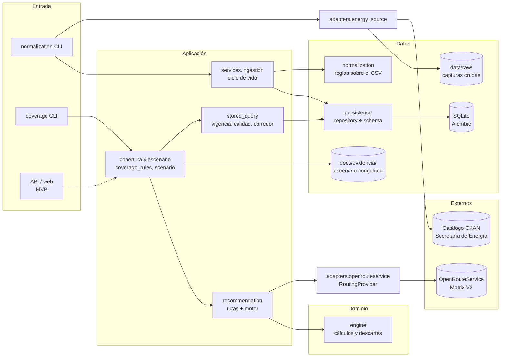
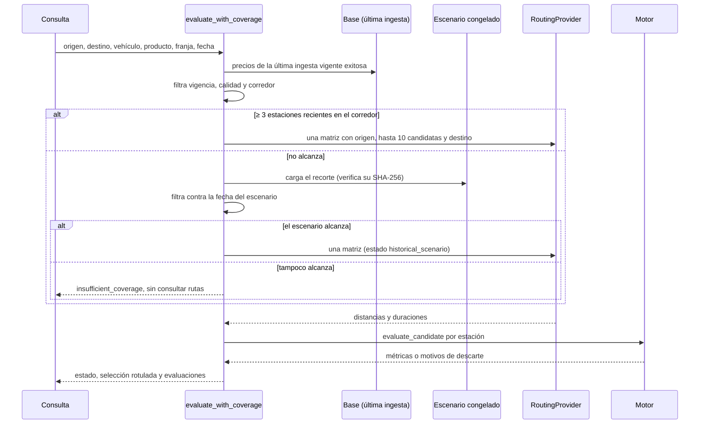
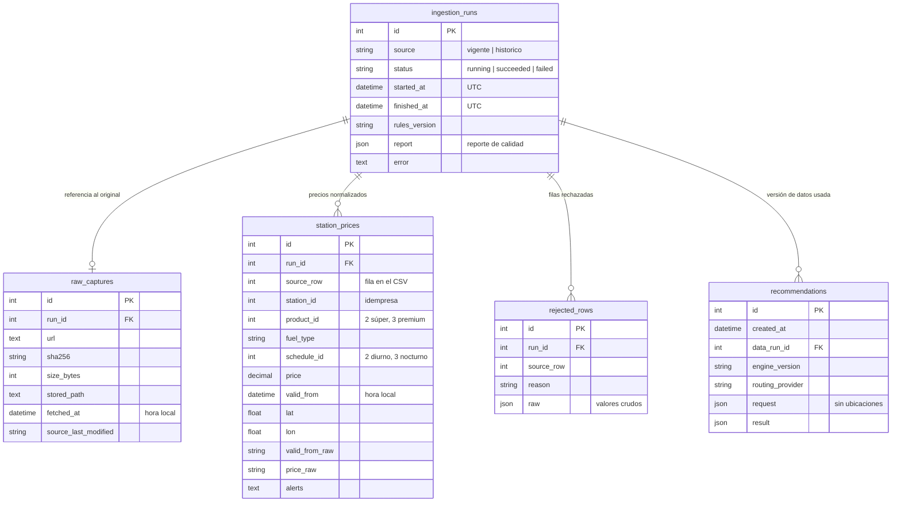

# SRD — Especificación técnica de Nafta2Go

Documento de requisitos y diseño del sistema (System Requirements/Design
Document) de la **Entrega 2: POC**. Traduce el [PRD](PRD.md) a una
especificación técnica:
- La arquitectura, con su patrón y sus diagramas.
- El stack tecnológico justificado.
- El modelo de datos.
- Los contratos de las interfaces principales.
- La estrategia de datos.

Como pide la consigna, **no incluye los componentes de ML**: el diagnóstico
estadístico de precios (RF10, RF11), su entrenamiento, serving y monitoreo
quedan para la entrega final. Solo se indica dónde se van a conectar.

Cada sección dice qué está **implementado en la POC** y qué está **diseñado
para el MVP**. El detalle de cada componente está en su documento:
[NORMALIZACION](NORMALIZACION.md), [PERSISTENCIA](PERSISTENCIA.md),
[COBERTURA](COBERTURA.md), [RUTAS](RUTAS.md), [MOTOR](MOTOR.md) y
[CALIDAD](CALIDAD.md). Las decisiones estructurales están en los
[ADRs](../adr/README.md).

## 1. Alcance de la POC

La POC valida el camino técnico de punta a punta para **un caso de uso**: un
conductor en CABA busca dónde cargar nafta súper o premium yendo de un origen a
un destino (UC01), o yendo y volviendo desde un origen (UC02). No hay interfaz
gráfica: los componentes se usan desde comandos y desde código.

El mayor riesgo del proyecto, la baja cobertura de precios recientes, quedó
resuelto en POC-02 de esta forma:
- La cobertura se mide cerca del recorrido.
- Si no alcanza, se usa un escenario histórico congelado y rotulado.
- Nunca se presentan precios viejos como actuales.

## 2. Trazabilidad con el PRD

| Requisito | Componente | Estado en la POC |
|---|---|---|
| RF01 Validar la consulta | `domain/engine.FuelRequest`, validaciones de `application/stored_query` | Implementado: rechaza valores faltantes, no numéricos, no finitos o inconsistentes nombrando el campo |
| RF02 Filtrar CABA y nafta compatible | `normalization/reading` (alcance), `stored_query` (producto, franja y caja de CABA) | Implementado |
| RF03 Preseleccionar y enrutar candidatas | `stored_query` (hasta 10 en el corredor), `application/recommendation.evaluate_stations` | Implementado con un máximo de 10 (el PRD admite hasta 20); se recorta por la cuota del proveedor |
| RF04 Cálculos de alcanzabilidad, reserva, consumo, capacidad, litros y desvío | `domain/engine.evaluate_candidate` | Implementado, determinístico |
| RF05 Descartar alternativas inviables con motivo | `domain/engine.DiscardReason`, exclusiones de `stored_query` | Implementado |
| RF06 Hasta tres alternativas diferenciadas | — | **Pendiente**: el motor evalúa candidatas pero todavía no arma el ranking (POC-05) |
| RF07 Explicar cada resultado | `FuelMetrics`, `StoredPrice` (fecha, fila, alertas) | Datos disponibles; falta la presentación (POC-05) |
| RF08 Ingerir y normalizar | `adapters/energy_source`, `normalization/`, `services/ingestion` | Implementado, con corrida real documentada |
| RF09 Umbral configurable de vigencia | `application/coverage_rules`, `stored_query` | Implementado: 30 días, configurable en un solo módulo |
| RF10 y RF11 Diagnóstico ML y ranking conservador | — | Fuera de la POC, por consigna. La alerta `precio_atipico` de la normalización es una regla, no un modelo |
| RF12 Autenticación administrativa | — | Fuera de la POC: no hay funciones administrativas expuestas |
| RF13 Configurar sin modificar código | — | Pendiente (Debería): hoy los parámetros son constantes de código |
| RF15 Escenarios históricos | `application/scenario`, `docs/evidencia/escenario-vigente-2026-10-24/` | Implementado como respaldo automático y rotulado |
| RNF03 Privacidad | `persistence/repository.record_recommendation` | Implementado: rechaza origen, destino y coordenadas en la consulta guardada |
| RNF05 Trazabilidad | `ingestion_runs`, `raw_captures`, `recommendations.data_run_id`, rótulo `scenario` | Implementado para datos; falta registrar recomendaciones desde el flujo (POC-05) |
| RNF06 Calidad | CI: links, lint, tests, secretos y contenedores | Implementado |
| RNF07 Portabilidad | `Dockerfile`, `compose.yaml`, configuración por variables de entorno | Parcial: el contenedor migra la base; falta el servicio de la aplicación |

## 3. Arquitectura

### Patrón

**Aplicación modular por capas con adaptadores** (puertos y adaptadores en los
bordes), según el [ADR-004](../adr/ADR-004-arquitectura-por-capas.md). Se eligió
frente a microservicios desde el inicio y frente a una arquitectura orientada a
eventos, porque el caso principal es una consulta síncrona que necesita una
respuesta explicada. Las reglas tienen que poder probarse sin red ni
infraestructura.

| Capa | Paquete | Responsabilidad | Depende de |
|---|---|---|---|
| Dominio | `nafta2go/domain/` | Reglas de negocio puras: cálculos de combustible, factibilidad y motivos de descarte | Nada del sistema |
| Aplicación | `nafta2go/application/`, `nafta2go/services/` | Casos de uso: seleccionar candidatas, decidir cobertura, conectar rutas y motor, orquestar la ingesta | Dominio, puertos de los adaptadores, persistencia |
| Normalización | `nafta2go/normalization/` | Reglas de calidad de datos sobre el CSV crudo | pandas |
| Persistencia | `nafta2go/persistence/` | Esquema, migraciones y repositorios | SQLAlchemy |
| Adaptadores | `nafta2go/adapters/` | Fuentes externas: catálogo de la Secretaría de Energía y OpenRouteService | requests |
| Entrada | `python -m nafta2go.normalization`, `python -m nafta2go.coverage`, `scripts/` | Comandos de la POC | Aplicación |

Las reglas de dependencia son estas:
- El dominio no importa nada de las otras capas.
- La aplicación habla con las rutas a través del protocolo `RoutingProvider` y
  nunca con OpenRouteService directamente.
- Ninguna capa de negocio escribe SQL: todo pasa por `repository`.

En el MVP se suman una capa de **presentación** (API HTTP y web) por encima de
la aplicación, y el **diagnóstico ML** como un componente separado que la
aplicación consulta (ver el [ADR-002](../adr/ADR-002-recomendador-deterministico-y-diagnostico-ml.md)).

### Diagrama de componentes

### Flujo de ingesta (implementado)

1. `discover_resources` lee el catálogo y encuentra los CSV vigente e histórico.
2. `download` baja el CSV a `data/raw/<origen>/`. Lo escribe primero como
   `.part` y lo renombra solo si el tamaño coincide con el del catálogo. Calcula
   el SHA-256.
3. `ingest` abre la ejecución en estado `running`, en su propia transacción.
4. `normalize_capture` lee por chunks, filtra CABA y nafta y aplica las reglas.
   Entrega las filas válidas, los rechazos con motivo y un reporte de calidad.
5. En una segunda transacción se guardan la referencia a la captura, los
   precios, los rechazos y el cierre `succeeded`. Si algo falla, se revierte
   todo y la ejecución queda `failed`.

### Flujo de consulta (implementado hasta la evaluación)

Lo que falta para cerrar el flujo (POC-05):
- Un punto de entrada que reciba la consulta.
- El ranking de hasta tres alternativas (RF06).
- La presentación explicada (RF07).
- El registro en `recommendations`.

## 4. Stack tecnológico

| Tecnología | Uso | Por qué | Alternativa considerada |
|---|---|---|---|
| Python 3.12 | Todo el sistema | Un solo lenguaje para datos, reglas y servicios. El equipo ya lo usa en la exploración. Tipado moderno y `zoneinfo` | — |
| pandas 2 | Normalización | El histórico tiene 3,4 millones de filas (780 MB). Se lee por chunks con operaciones vectorizadas: unos 2 minutos y 630 MB de memoria | Leer con el módulo `csv` fila por fila (más lento y más código) |
| `decimal.Decimal` | Motor y precios | Litros e importes sin errores de punto flotante, con redondeo explícito. El costo nunca supera el presupuesto | `float` |
| requests | Catálogo, descarga y rutas | Sesión inyectable: los tests reemplazan la red por una sesión falsa | httpx (no hace falta asincronía en la POC) |
| SQLite + SQLAlchemy 2 Core + Alembic | Persistencia | Sin servidor, transaccional y suficiente para el volumen de la POC (~730 filas por captura vigente). SQLAlchemy permite pasar a PostgreSQL en el MVP sin reescribir los repositorios. Alembic versiona el esquema | PostgreSQL desde el inicio; archivos CSV/JSON ([ADR-005](../adr/ADR-005-persistencia-de-la-poc.md)) |
| OpenRouteService Matrix V2 | Distancias y tiempos | Una sola solicitud por consulta devuelve todos los tramos. La cuota diaria alcanza ([RUTAS](RUTAS.md)) | OSRM propio, que queda como plan alternativo detrás del mismo protocolo ([ADR-003](../adr/ADR-003-proveedor-de-rutas.md)) |
| Docker + Compose | Ejecución local y CI | Misma imagen en la máquina y en el CI. Prepara la salida a cloud (RNF07) | Instalación local únicamente |
| GitHub Actions | Integración continua | Checks requeridos en `dev` y `main`: links, ruff, pytest, gitleaks y contenedores ([CALIDAD](CALIDAD.md)) | — |
| pytest + ruff | Calidad | Tests sin red y con bases temporales. Un único linter y formateador | flake8 + black |

## 5. Modelo de datos

Estas son las reglas del modelo:

- **Una ejecución es una versión de datos.** Una consulta lee precios de una
  sola ejecución `succeeded` y nunca mezcla capturas.
- **Valores originales.** `valid_from_raw`, `price_raw`, `source_row` y
  `rejected_rows.raw` conservan lo que dijo la fuente. El archivo crudo se
  referencia por su SHA-256 y no se guarda en la base.
- **Clave de precio.** `(run_id, station_id, product_id, schedule_id,
  valid_from)` es única.
- **Zonas horarias.** Las fechas de la ejecución van en UTC. `valid_from` y
  `fetched_at` van en hora local de Argentina sin zona, como publica la fuente.
- **Privacidad (RNF03).** `recommendations.request` no admite origen, destino
  ni coordenadas.
- **Escenario histórico.** No es una tabla: se lee desde
  `docs/evidencia/escenario-vigente-2026-10-24/` y no se ingiere. Así nunca
  puede tomarse como la última captura.

## 6. Contratos de las interfaces principales

### Externos

| Interfaz | Contrato | Errores |
|---|---|---|
| Catálogo CKAN (`package_show?id=precios-en-surtidor`, por HTTP) | Recursos CSV cuyo nombre contiene "vigentes" e "historicos", con `url`, `size` y `last_modified` | Falta un recurso → `LookupError`. Bytes recibidos ≠ `size` → `IncompleteDownload`, sin dejar archivo |
| CSV vigente | 19 columnas; `fecha_vigencia` en formato `AAAA-MM-DD HH:MM:SS`; precio entero | Columnas faltantes → `UnexpectedSchema` con sus nombres |
| CSV histórico | 18 columnas, incluidas `anio` y `mes`; `fecha_vigencia` en formato `DD/MM/AAAA HH:MM` (día primero) | Ídem |
| OpenRouteService Matrix V2 | Hasta 22 ubicaciones (origen, 20 candidatas y destino); timeout de 5 s de conexión y 15 s de lectura | `InvalidCredentials`, `QuotaExceeded`, `InvalidRequest`, `ProviderTimeout`, `ProviderUnavailable` (todos son `RoutingError`) |

### Internos

| Interfaz | Entrada | Salida |
|---|---|---|
| `RoutingProvider.matrix(sources, destinations)` | Listas de `Point(lat, lon)` | `DistanceMatrix`: metros y segundos, `None` si un par no tiene ruta |
| `normalize_capture(RawCapture)` | Captura guardada: origen, URL, SHA-256, ruta y `fetched_at` | `NormalizationResult`: filas válidas, rechazos con `motivo`, reporte y `rules_version` |
| `ingest(engine, capture, normalize)` | Captura y normalizador | `run_id`; si falla, `IngestionFailed` y la ejecución queda `failed` |
| `evaluate_candidate(FuelRequest, precio, Route)` | Consumo, tanque, litros iniciales, presupuesto, reserva; tramos en km y min | `Evaluation`: `FuelMetrics` si es factible, o motivos de `DiscardReason` |
| `select_with_coverage` / `evaluate_with_coverage` | Origen, destino opcional, producto, franja, fecha con zona | `CoverageQueryResult`: estado, selección usada y rotulada, selección actual, selección del escenario y evaluaciones |

Estados de cobertura (`CoverageStatus`):

| Estado | Significado |
|---|---|
| `ready` | Datos actuales: al menos 3 estaciones recientes en el corredor |
| `historical_scenario` | Escenario congelado, rotulado con su fecha de referencia |
| `insufficient_coverage` | No alcanza ninguna fuente; no se consultan rutas |
| `no_successful_ingestion` | Estado de la selección actual cuando todavía no hay ingesta exitosa |

Motivos de descarte del motor: `route_unavailable`, `station_unreachable`,
`reserve_at_station`, `no_budget`, `no_tank_space` e
`insufficient_fuel_for_trip`.

Exclusiones de la selección: `incompatible_product`, `incompatible_schedule`,
`future_price`, `stale_price`, `invalid_price`, `missing_coordinates`,
`invalid_coordinates`, `outside_caba`, `outside_corridor` y
`superseded_price`.

### Comandos

| Comando | Qué hace |
|---|---|
| `python -m nafta2go.normalization --source {vigente,historico} [--file RUTA]` | Descarga (o usa un CSV), normaliza, ingiere e imprime el reporte |
| `python -m nafta2go.coverage --origin=LAT,LON [--destination=LAT,LON]` | Reporta la cobertura y la decisión de la consulta, sin consultar rutas |
| `python scripts/probe_openrouteservice.py` | Prueba autenticada del proveedor de rutas |
| `python scripts/freeze_scenario.py --file ...` | Congela un escenario histórico |

## 7. Estrategia de datos

| Aspecto | Decisión |
|---|---|
| Fuente | Dataset oficial "Precios en surtidor" de la Secretaría de Energía, licencia CC BY 4.0. Vigente (~9 MB) e histórico (~780 MB) |
| Captura | Descarga completa por HTTP. El portal redirige HTTPS a HTTP y el DataStore ya no existe. La integridad se cubre con el tamaño del catálogo y el SHA-256. El crudo queda en `data/raw/` (no versionado) y nunca se modifica |
| Alcance | CABA (`provincia` CAPITAL FEDERAL) y nafta súper o premium. Se descartan en la lectura |
| Calidad | Reglas explícitas que **no corrigen datos**: rechazan con motivo (fecha inválida, futura o inconsistente, precio inválido o no positivo, clave en conflicto) o marcan una alerta (precio atípico, fuera de CABA, sin coordenadas) ([NORMALIZACION](NORMALIZACION.md)) |
| Fechas | Formato fijo por origen. Leer el histórico con el mes primero explicaba las fechas futuras de la Entrega 1 |
| Versionado | Cada ingesta es una versión (`run_id`) con su captura, reglas (`rules_version`) y reporte. Las recomendaciones apuntan a esa versión |
| Vigencia y cobertura | Un precio es reciente si tiene hasta 30 días. Se exigen 3 estaciones recientes en un corredor de 5 km del recorrido. Los parámetros están en `coverage_rules.py` ([COBERTURA](COBERTURA.md)) |
| Respaldo | Escenario histórico congelado (vigente del 24/10/2026, 732 filas versionadas con su SHA-256), activado solo y rotulado ([ADR-006](../adr/ADR-006-escenario-historico-de-la-poc.md)) |
| Frecuencia | En la POC, la ingesta se corre a mano con el comando. En el MVP será diaria y programada (RF08), con alerta si falla |
| Privacidad | No se guardan ubicaciones de usuarios. Los datos de la fuente son públicos y de empresas |
| Datos para ML | El histórico normalizado (80.008 filas válidas de CABA, 2015-2026) queda disponible para el diagnóstico de la entrega final. Su diseño no forma parte de este documento |

## 8. Calidad, configuración y operación

- **Integración continua:** cinco checks en cada push y PR a `dev` y `main`:
  `Docs y notebooks`, `Lint`, `Tests`, `Secretos` y `Contenedores`. Los cuatro
  primeros son requeridos por el ruleset ([CALIDAD](CALIDAD.md)).
- **Tests:** unitarios para dominio y reglas, de integración contra un SQLite
  migrado y de contrato con sesiones HTTP falsas. Ningún test usa red. Las
  fixtures salen de filas reales de la fuente.
- **Configuración:**
  - `DATABASE_URL` y `ORS_API_KEY`, por variables de entorno, con un
    `.env.example` sin valores reales.
  - Los parámetros de negocio están en `coverage_rules.py` y `normalization/rules.py`.
- **Ejecución local:** con `python -m pip install -r requirements-dev.txt`
  y `alembic upgrade head`, o con `docker compose up --build`, que construye la
  imagen y migra la base en un volumen.
- **Observabilidad:** las ingestas y las descargas registran logs con campos
  (`run_id`, filas, rechazos, SHA-256). El reporte de calidad queda en cada
  ejecución. Las métricas y alertas de RNF08 son del MVP.

## 9. Partes simplificadas en la POC

| Parte | Simplificación | Plan para el MVP |
|---|---|---|
| Interfaz | No hay API ni web: comandos y código | API HTTP y web por encima de la capa de aplicación |
| Ranking | El motor evalúa hasta 10 candidatas pero no elige las tres alternativas de RF06 | Ranking por combustible neto, menor desvío y equilibrio |
| Candidatas | Hasta 10 en lugar de 20, preseleccionadas por recencia dentro del corredor | Evaluar si la cuota permite 20 |
| Corredor | Desvío estimado en línea recta | Se mantiene como prefiltro; el desvío real ya lo calcula el motor |
| Escenario histórico | Una sola captura congelada | Congelar capturas nuevas con el mismo script |
| Ingesta | Manual | Programada y diaria, con alerta |
| Base | SQLite local | PostgreSQL si hace falta concurrencia (ADR-005) |
| Parámetros | Constantes de código | Configurables y auditados (RF13) |
| Caja de CABA | Rectángulo, no polígono | Polígono oficial de la ciudad |
| Diagnóstico de precio | Regla de precio atípico (3 veces la mediana del mes) | Componente ML separado (ADR-002) |

## 10. Riesgos técnicos abiertos

| Riesgo | Mitigación |
|---|---|
| La cobertura reciente cae (en la Entrega 1 eran 2 de 184 estaciones) | Respaldo automático con el escenario histórico rotulado; el reporte de cobertura lo hace visible |
| El proveedor de rutas cambia de host o de cuota (ya pasó con el host anterior) | Protocolo `RoutingProvider`; OSRM como alternativa; el límite por minuto todavía no está verificado ([RUTAS](RUTAS.md)) |
| La fuente cambia columnas o formato | `UnexpectedSchema` falla nombrando lo que falta y la ejecución queda `failed` |
| Coordenadas mal cargadas (dos estaciones con provincia CABA están fuera de la ciudad) | Alerta `fuera_de_caba`, que se excluye de la selección |
